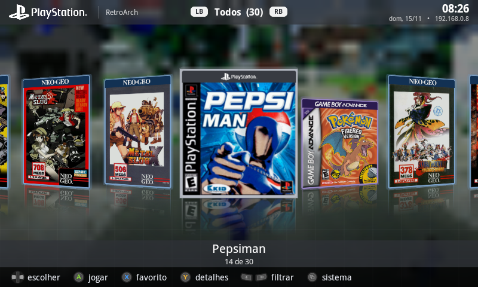
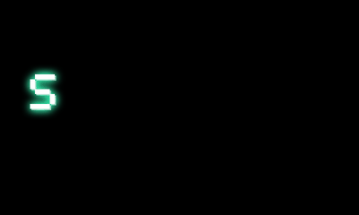
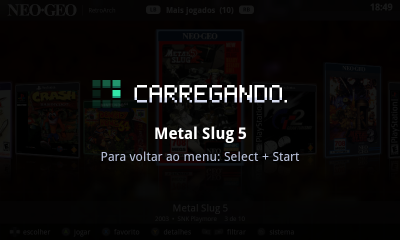

# ScrapCade no iChroma

<p align="center"></p>

<p align="center">
  
  
  
  
</p>

**Analisador de laboratório que ia para o lixo eletrônico, agora fliperama.** O iChroma II (ARM de 1 GHz, 512 MB, tela de 800x480) liga direto no **ScrapCade**, o mesmo menu do [ScrapCade OS](https://github.com/thiagotechmaker/scrapcade.os), em Java e pela GPU.

<p align="center"><a href="https://github.com/thiagotechmaker/scrapcade-fliperama/releases/latest"><b>Baixar o app (APK)</b></a> · <a href="https://thiagotechmaker.github.io/scrapcade/#ichroma">Site</a> · <a href="https://github.com/thiagotechmaker/scrapcade-fliperama/discussions">Conversas</a></p>

## Sobre e capturas

Duas partes: o **menu** (um app Android, `com.thiago.launcher`, que vira a tela inicial) e as **mudanças no sistema** do aparelho (driver de controle `joyd`, logo no boot, áudio que não trava, ADB pela rede). O passo a passo para montar está em [INSTALACAO.md](INSTALACAO.md).



<details><summary>Ver mais capturas e fotos</summary>

<p align="center"></p>
<p align="center"> </p>
<p align="center"> </p>
<p align="center"> </p>

</details>

<details><summary>Ver tudo o que o menu faz</summary>

- **Menu:** carrossel de capas no formato de cada caixa, filtros por console, "Continuar jogando", favoritos, perfis ("Quem vai jogar?"), 8 temas ou uma imagem sua, proteção de tela com as cenas dos jogos, animação de boot e CARREGANDO.
- **Jogos:** página no navegador (`http://IP:8080`) para enviar jogos e gerenciar arquivos, pen drive, pasta `Jogos novos`; cada jogo vai para o console certo, com capa e dados. Mesmas pastas do ScrapCade OS (`roms`, `saves`, `bios`, `themes`).
- **Painel Sistema** (SELECT): gerenciador de arquivos, BIOS dos consoles, cópia dos saves no pen drive, filtro de imagem, FPS, clock da GPU, relógio 12/24 h.
- Em qualquer jogo, SELECT + START volta ao menu; no arcade e no Neo Geo, SELECT põe ficha.

</details>

## Hardware suportado

| Item | Situação |
|---|---|
| Placa | iChroma II (Boditech): Samsung S5PV210, ARM Cortex-A8 de 1 núcleo a 1 GHz, 512 MB, NAND de 256 MB |
| Vídeo | ✅ PowerVR SGX540 (OpenGL ES 2, clock de 133 a 222 MHz pelo menu), tela de 800x480 |
| Controle | ✅ USB Xbox 360 e genéricos, pelo `joyd` (o kernel não tem driver para eles) |
| Rede | ✅ cabo (eth0) · ❌ Wi-Fi e Bluetooth |
| Som | ❌ o codec de áudio da placa não responde (a biblioteca original reinicia o aparelho) |
| Armazenamento | ✅ cartão SD e pen drive na porta USB de cima · ❌ cabo mini USB no PC (aparece como adaptador serial) |

<details><summary>Ver os emuladores e a velocidade de cada console</summary>

| Console | Emulador | Situação |
|---|---|---|
| PlayStation | RetroArch 0.9.9.6 + PCSX ReARMed | ✅ Crash a 50 qps, Gran Turismo 2 |
| Super Nintendo | RetroArch + Snes9x 2005 | ✅ 60 qps |
| Mega Drive, Master System, Game Gear | RetroArch + PicoDrive | ✅ 60 qps |
| NES | RetroArch + QuickNES | ✅ 60 qps |
| Game Boy Advance | My Boy! Free | ✅ |
| Game Boy, Game Boy Color | GBCoid | ✅ |
| Nintendo 64 | Mupen64Plus AE 2.4.4 | 🟡 17 a 39 qps, conforme o jogo; analógico funciona como direcional |
| Neo Geo e arcade | RetroArch + FB Alpha 2012 | ✅ 60 qps (Final Fight EUA de 1990 não roda) |
| Doom (`.wad`) | RetroArch + PrBoom | ✅ 60 qps |
| Half-Life | Xash3D | ✅ 60 qps |
| PSP, Saturn, Dreamcast, Nintendo DS | — | ❌ pesados demais para 1 núcleo a 1 GHz |

Nenhum emulador ou jogo está neste repositório; os emuladores são instalados à parte.

</details>

**Pela placa ficam de fora:** som, Wi-Fi, Bluetooth, pasta na rede do Windows, SSH, brilho, modo desktop, instalar, atualizar sozinho, jogos grátis e conquistas (o Android 2.3 não abre os sites atuais em HTTPS).

## Estrutura de pastas

```
.
├── launcher/        o menu ScrapCade (app Android em Java): carrossel pela GPU, painel, perfis, temas, organizador,
│                    capas e página no navegador; build.ps1 gera o launcher.apk
├── joypad/          joyd, o driver do controle em C sem libc (roda como root): controle USB vira teclas, abre os
│                    emuladores; scripts do N64, Half-Life e cabo USB
├── art_src/         scripts que geram a arte (logo, logos dos consoles), os índices de dados (CRC, nomes,
│                    metadados) e o que grava a logo no kernel
├── scripts/         publicar.ps1: publica uma versão (confere APK, CHANGELOG e tag)
├── capturas/        capturas da tela do aparelho
├── fotos/           fotos do aparelho
└── INSTALACAO.md    tutorial para montar num aparelho
```

As modificações de bootloader, kernel e bibliotecas do sistema não estão aqui, porque dependem do firmware do aparelho. APKs e imagens prontas vão só nas Releases, nunca nos commits.

## Como compilar

No Windows, com o **Android SDK** (build-tools 37 e a plataforma android-36.1), o **JDK** (javac e keytool) e, para o driver, o **Zig 0.17**:

```powershell
cd launcher; .\build.ps1      # gera launcher.apk (javac -> d8 -> aapt -> zipalign -> apksigner com assinatura v1, para o Android 2.3)
cd joypad;   .\build.ps1      # gera joyd (ARM estático, sem libc)
adb connect <IP do aparelho>:5555
adb install -r launcher\launcher.apk
```

O aparelho precisa estar com root e com o sistema preparado para o driver: o passo a passo está em [INSTALACAO.md](INSTALACAO.md). O histórico de versões está no [CHANGELOG.md](CHANGELOG.md).

## Licença

Código do ScrapCade e do `joyd`: **GPLv3** (ver [LICENSE](LICENSE)).

<details><summary>Ver as licenças dos recursos de terceiros</summary>

- Ícones de sistema: libretro/retroarch-assets, CC-BY 4.0 (ver `launcher/assets/icons/CREDITOS.txt`).
- Botões: Xelu's Free Controller Prompts, CC0.
- Índices de CRC (`launcher/assets/crc`): derivados do libretro-database (metadados e nomes No-Intro), CC BY-SA 4.0; estes arquivos seguem a mesma licença.
- Índice de nomes de Neo Geo e arcade (`launcher/assets/fbneo.idx`): derivado de listas de nomes do MAME/FBNeo, sem licença confirmada.
- Logotipos de consoles e marcas (Nintendo, Sega, Sony etc.) são dos seus titulares e aparecem apenas para identificação. O tema de origem es-theme-carbon não tem licença confirmada.
- Capas de jogos nas capturas e nas fotos são de terceiros e não fazem parte do código.
- Inspirações: o carrossel do Aurora (Xbox 360) e a organização de pastas do Batocera; nenhum arquivo deles foi copiado.

</details>

Projeto sem fins lucrativos. O aparelho veio de descarte clínico: os dados da iChroma foram apagados, e nada de pacientes é lido, copiado ou publicado.
