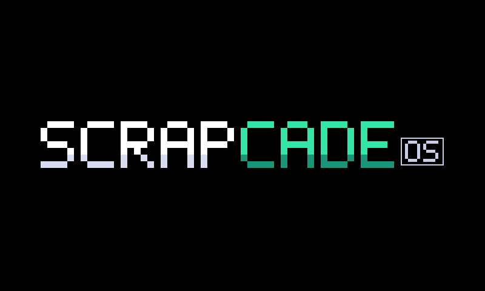
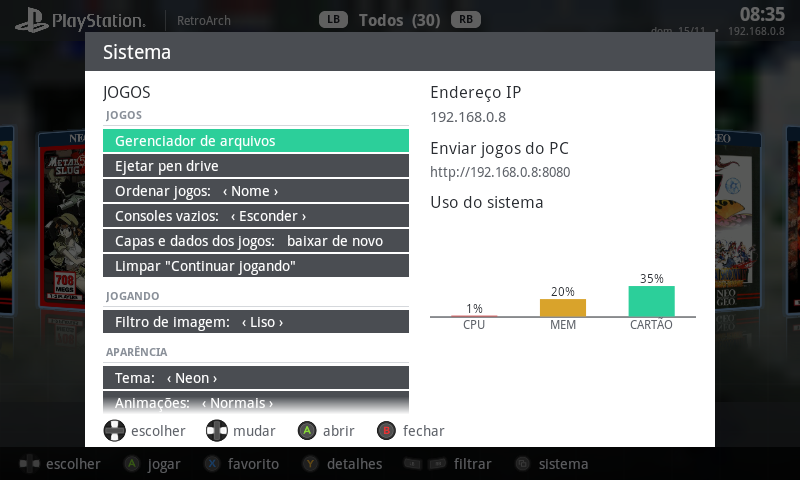
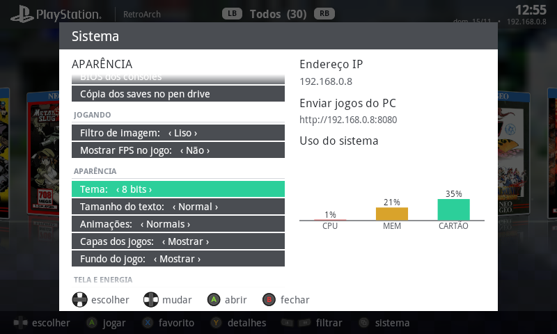
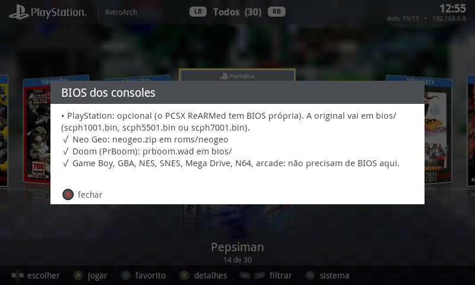
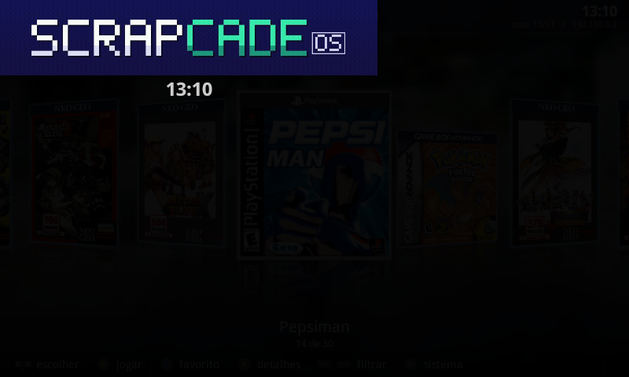

# ScrapCade no iChroma: fliperama no Android 2.3

<p align="center"></p>

Um analisador de laboratório **iChroma II** que ia para o lixo eletrônico virou fliperama: placa ARM de 1 núcleo a 1 GHz (S5PV210), 512 MB de memória, tela de 800x480 e Android 2.3.3. O menu é o **ScrapCade**, o mesmo da versão para computadores, o [ScrapCade OS](https://github.com/thiagotechmaker/scrapcade.os), cada um dentro do que a sua máquina aguenta.

## As duas versões do ScrapCade

| | **ScrapCade no iChroma** (este repositório) | **ScrapCade OS** (PC) |
|---|---|---|
| Máquina | placa ARM de 1 núcleo, 512 MB, tirada do lixo eletrônico | PCs e notebooks de 64 bits (32 bits em breve) |
| Sistema | Android 2.3 do aparelho, com bootloader, kernel e boot modificados | Linux próprio, montado com o Buildroot |
| Menu | ScrapCade em Java (o original) | ScrapCade em C++ e SDL2 |
| Emuladores | os leves: até PlayStation 1 e Nintendo 64, com limites | todos os que o PC aguentar |

Os dois têm o mesmo carrossel de capas, o mesmo painel Sistema em seções, o mesmo gerenciador de arquivos e as mesmas pastas (`roms/<console>`, `Jogos novos`, `saves`, `bios`). O que nasce num é levado para o outro, dentro do que cada máquina aguenta.

## O que tem no aparelho

- **ScrapCade, o menu.** É um app Android próprio (`com.thiago.launcher`), em Java, configurado como tela inicial. Dá para atualizar ou desinstalar sem mexer no sistema.
- **Mudanças no sistema do aparelho:**
  - driver do controle (`joyd`), em C, iniciado no boot;
  - logo do ScrapCade OS gravada no bootloader e no kernel, e na animação de boot do Android;
  - biblioteca de áudio muda (a original trava o aparelho);
  - boot mais rápido (apps de sistema pré-compilados);
  - ADB pela rede, para manutenção.

Este repositório tem o código do ScrapCade e do `joyd`. As modificações de bootloader, kernel e bibliotecas do sistema não estão aqui, porque dependem do firmware do aparelho.

## Como é

Liga direto no menu: um carrossel de capas no formato de cada caixa, com filtros por console, **Continuar jogando** (os últimos 12 abertos), favoritos, mais jogados e os dados de cada jogo (ano, empresa, gênero).


O **painel Sistema** (botão SELECT) segue a mesma ordem do ScrapCade OS, em seções como o menu de ajustes de um console:

- **JOGOS:** gerenciador de arquivos, ejetar pen drive, ordenar jogos (nome, ano, mais jogados, últimos), consoles vazios, capas de novo, limpar "Continuar jogando", BIOS dos consoles, cópia dos saves no pen drive.
- **JOGANDO:** filtro de imagem (liso ou nenhum), FPS na tela.
- **APARÊNCIA:** 8 temas (Carbono, Neon, Arcade, Claro, Aurora, 8 bits, Portátil, Oceano), tamanho do texto, animações, capas, fundo do jogo, proteção de tela.
- **TELA E ENERGIA:** clock da GPU, desenho do menu (GPU ou CPU), relógio 12/24 h.
- **REDE:** enviar jogos do PC pelo navegador.
- **SISTEMA:** aplicativos, configurações do Android, como jogar, informações, voltar tudo ao padrão, reiniciar.





**BIOS dos consoles** confere o que cada emulador precisa. A **proteção de tela** escurece a tela com a logo e a hora quando o menu fica parado (5, 10 ou 30 minutos), e qualquer botão volta sem fazer nada.





O **gerenciador de arquivos** funciona pelo controle e pela página no navegador (porta 8080): A abre, Y mostra as ações (copiar, mover, clonar, apagar), X cola na pasta aberta.


## Colocar jogos

1. Copie o jogo para a pasta **Jogos novos** do cartão, ligue um pen drive na porta USB de cima, ou envie pelo navegador (`http://IP:8080`, o IP aparece no alto da tela).
2. O organizador leva o arquivo para a pasta do console. Ele só mexe em arquivo que parou de crescer, para não pegar cópia pela metade.
3. Com a rede ligada, o menu baixa sozinho a capa e a imagem de fundo, e preenche ano, empresa e gênero.
4. Escolha o jogo com o controle e aperte A: o menu abre o emulador certo direto no jogo.

**Em qualquer jogo:** SELECT + START volta ao menu. **Arcade e Neo Geo:** SELECT põe ficha, START começa.

## O que tem aqui

- `launcher/`: o app de menu (Java, Android 2.3). Carrossel de capas pela GPU, painel em seções, temas, favoritos, mais jogados, "Continuar jogando", fundo do jogo, proteção de tela, gerenciador de arquivos pelo controle e pela página no navegador (porta 8080), e o organizador da pasta "Jogos novos".
- `joypad/`: `joyd`, o driver do controle em C sem libc (roda como root no aparelho). Lê comandos de um arquivo (`game`, `ra <núcleo> <jogo>`, `n64 <jogo>`, `xash`, `hora`, `gpu`, `reboot`), converte o controle USB em teclas e abre os emuladores.
- `art_src/`: scripts que geram a arte (logo, logos brancos dos consoles) e os índices de dados (CRC, nomes, metadados) a partir de fontes públicas, e o que grava a logo no kernel.

## Emuladores usados

Nenhum emulador ou jogo está neste repositório. Os emuladores são instalados à parte: RetroArch 0.9.9.6 com núcleos libretro (FB Alpha 2012, Snes9x 2005, PicoDrive, QuickNES, PCSX ReARMed, PrBoom), Mupen64Plus AE 2.4.4, My Boy! Free e Xash3D.

## Limitações conhecidas

- **Sem som:** a biblioteca de áudio original do aparelho reinicia o sistema ao abrir um jogo com áudio.
- **Nintendo 64** roda a 17–39 quadros por segundo, conforme o jogo. O analógico funciona como direcional: o Android 2.3 não reconhece o eixo como joystick.
- **Cabo USB no PC** não funciona na porta mini USB (ela aparece como adaptador serial). Use o pen drive na porta de cima ou a página na porta 8080.
- **Final Fight** (versão EUA de 1990) não roda no FB Alpha 2012: o núcleo só aceita outras revisões do jogo.
- **Pela placa ficam de fora:** Wi-Fi, Bluetooth, pasta na rede do Windows, SSH, brilho, modo desktop, instalar, atualizar sozinho, jogos grátis e conquistas (o Android 2.3 não abre os sites atuais em HTTPS). PSP, Saturn, Dreamcast e Nintendo DS são pesados demais para 1 núcleo a 1 GHz.
- **Ainda por fazer:** perfis com avatar ("Quem vai jogar?"), tema com imagem sua e idioma.

## Aparelho


As capas dos jogos e os logos dos consoles nas capturas e nas fotos são de terceiros.

## Inspirações

- **Aurora** (dashboard do Xbox 360): a ideia do carrossel de capas em destaque, com o título embaixo e o reflexo no chão, e a barra de cima com as etiquetas LB/RB para filtrar.
- **Batocera** (sistema de emuladores para PC e placas): a organização por pasta de console (`roms/<console>`) e a pasta de capas `images/` ao lado de cada jogo, com nomes iguais aos do acervo.

O desenho, as capas em carrossel e o código são próprios. Nenhum arquivo do Aurora ou do Batocera foi copiado.

## Como compilar

Precisa de Android SDK (build-tools 37), JDK e, para o driver, Zig 0.17.

```powershell
cd launcher; .\build.ps1      # gera launcher.apk
cd joypad;   .\build.ps1      # gera joyd (ARM estático)
```

O aparelho precisa estar com root e com o sistema alterado para aceitar o driver. Este repositório não traz isso.

## Licenças

- Ícones de sistema: libretro/retroarch-assets, CC-BY 4.0 (ver `launcher/assets/icons/CREDITOS.txt`).
- Botões: Xelu's Free Controller Prompts, CC0.
- Índices de CRC (`launcher/assets/crc`): derivados do libretro-database (metadados e nomes No-Intro), licença **CC BY-SA 4.0**. Estes arquivos seguem a mesma licença.
- Índice de nomes de Neo Geo e arcade (`launcher/assets/fbneo.idx`): derivado de listas de nomes do MAME/FBNeo, sem licença confirmada.
- Logotipos de consoles e marcas (Nintendo, Sega, Sony etc.) são de seus titulares e aparecem apenas para identificação. O tema de origem es-theme-carbon não tem licença confirmada.
- Capas de jogos que aparecem nas capturas e nas fotos são de terceiros e não fazem parte do código.
- Este projeto não tem fins lucrativos.
